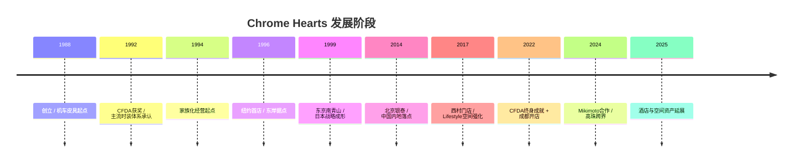

# Chrome Hearts 品牌与行业背景补完研究报告

## 执行摘要

未检索到可直接引用的内部文件，本报告基于公开资料整理，并按你已确认的写法执行：无导语、正文优先、问题/认知驱动、并以 **Level A（官方/一手公开资料）—Level B（多源公开资料与行业共识）—Level C（圈内观点/争议）** 分级。核心结论是：Chrome Hearts 的关键不是“银饰爆款”，而是通过 **家族经营、门店稀缺、跨品类空间叙事、日本高密度布局、中国谨慎落点、以及联名筛选机制**，把一个机车皮具品牌做成了高门槛的生活方式系统。citeturn7view0turn8view0turn6view0turn15view0

## 品牌时间轴

| 年份 | 事件 | 等级 | 影响评述 |
|---|---|---:|---|
| 1988 | Richard Stark、John Bowman、Leonard Kamhout 在洛杉矶创立 Chrome Hearts。citeturn21search8turn21search0 | A | 起点是机车皮具与银质五金，不是“先天银饰品牌”。 |
| 1992 | 获 CFDA Accessories Designer of the Year。citeturn9search16turn1search6 | A | 把地下机车审美带入美国时装体系，是第一次“被主流认证”。 |
| 1994 | Leonard、John 退出；Laurie Lynn 加入并与 Richard 共同持有/经营。citeturn21search0turn8view0 | A | 家族化经营从这里真正开始。 |
| 1996 | 纽约首店落地，上东区成为美国东岸据点。citeturn16search8turn16search17 | B | 从“圈内定制”走向“城市店铺与空间叙事”。 |
| 1999 | 东京南青山旗舰开业。citeturn1search12turn6view0 | A | 日本成为亚洲第一战略市场。 |
| 2003 | 香港 Prince’s Building 开店。citeturn5view0 | B | 为华语市场与亚洲高端百货体系铺路。 |
| 2014 | 北京银泰 in01 店公开开业。citeturn10search6turn10search13 | A | 中国内地正式落点，且与高端商业地产绑定。 |
| 2017 | 纽约 West Village 新店开业，形成纽约双据点。citeturn16search0turn16search8 | A | 品牌从珠宝/服饰零售进一步走向完整 lifestyle 陈列。 |
| 2022 | Richard 与 Laurie Lynn 获 CFDA Geoffrey Beene Lifetime Achievement Award；成都店开业。citeturn9search0turn10search2 | A | 前者是长期影响力盖章，后者显示中国扩张仍走精选物业路线。 |
| 2024 | 与 Mikimoto 推出珍珠珠宝合作。citeturn13search7turn13search15 | A | 证明 CH 能把“硬派哥特”延伸到高珠语境。 |
| 2025—2026 | 公开报道显示品牌切入酒店/空间资产；官方位置页至 2026-07 列出约 37 个全球销售点位，其中日本 10 个、内地 3 个。citeturn21news17turn6view0turn5view0 | B | CH 正在把“生活方式”延展为“空间与接待”。 |

## 关键节点深度解析

**CFDA 为什么重要？** 因为它不是销售节点，而是“话语权节点”。1992 年之前，Chrome Hearts 更像服务机车/摇滚圈的小众工坊；CFDA 之后，它第一次被美国主流时尚系统承认为“配饰设计力量”。这不是品牌成功的起点，但它把品牌从圈层语境推进到行业语境。citeturn9search16turn1search6

**纽约与东京旗舰为什么关键？** 纽约让 CH 从洛杉矶工坊变成全国性的奢侈/时尚零售玩家；东京南青山则让它进入最懂买手、工艺与限量逻辑的市场。到 2026 年，官方位置页仍显示日本拥有 10 个销售点，是全球最密集的单一国家网络之一。日本不是“卖得好”这么简单，而是把 CH 训练成了一个会经营收藏文化、限量文化与选品差异化的品牌。citeturn16search8turn1search12turn6view0turn8view0

**Laurie Lynn 为什么是转折点？** CFDA 会员页明确写到，Chrome Hearts 并不按季发布，而是由 Laurie Lynn、Richard 与 Jesse Jo 依据创作直觉推进新品；GQ 则补足了另一面：Laurie 1994 年加入后，承担了空间、媒体、家族经营与对外形象的整合。也就是说，Richard 更像“制造与方向”，Laurie 更像“把方向变成系统”。citeturn7view0turn8view0

**日本市场为什么会崛起？** 公开可验证的事实是：日本门店密度高、关键店实行预约优先；GQ 还提到工厂曾为包括日本在内的门店网络高负荷运转。更重要的是，2026 年 Jing Daily 指出东京的 Chrome Hearts 转售生态围绕“稀缺、真伪、档案价值”展开。换句话说，日本市场把 CH 从“穿戴品”推进成“可研究对象”。citeturn6view0turn8view0turn11search13

**中国银泰合作意味着什么？** Level A 的事实是：北京店位于北京银泰 in01，成都店位于成都银泰 in99；北京 2014 年开业现场还出现银泰负责人。Level B 的行业判断是：CH 在内地并没有走大面积铺店，而是绑定高端物业与城市地标，以门店本身维持筛选与稀缺。也因此，中国市场更像“低点位、高话题、高二级流通敏感度”的结构。citeturn10search13turn10search6turn10search2turn5view0

## 人物贡献扩展

**Richard Stark**：公开资料可确认他是创始核心、早年做高等级皮料生意、做过木工并长期扎在工厂现场；他口中的目标是把 CH 做成“150 年家族企业”。这意味着他最大的贡献，不是某件单品，而是把“自制、慢扩张、强控制”变成企业方法。citeturn8view0turn7view0

**Laurie Lynn Stark**：公开事实是 1994 年后她进入核心经营层，CFDA 对她的表述直接把新品节奏、家族协作与创作机制绑定到她身上。她的贡献更接近“把审美生产转成品牌系统”，包括空间、媒体、陈列、跨品类扩张与家族化品牌治理。citeturn7view0turn9search0

**Leonard Kamhout**：公开事实仅限于“联合创始人、早期银匠、后来自立门户”；其后与 Lone Ones 的关系可由日本官方零售/品牌介绍确认。至于“哪些 CH 经典元素主要出自 Leonard”，属于 **Level C 圈内观点**，可以整理，但不宜写成定论。citeturn20search0turn20search1turn21search0

**John Bowman**：公开可确认信息相对最少，但可稳妥确认其为皮革制造端角色。换言之，John 的意义不是后期曝光，而是补齐了 CH 起点阶段最重要的“骑行皮具能力”。由于公开材料稀少，他在知识库里应标为 **A 级身份事实，B 级贡献推断**。citeturn21search0

**家族成员**：公开资料已能确认 Jesse Jo 参与创意，Kristian 被 GQ 直接写成帮助 CH 接入新一代客户与明星资源的关键人物；Frankie Belle 的公开职责最少。家族成员的真正价值不是“星二代光环”，而是把品牌延续问题提前内化成组织机制。citeturn7view0turn8view0

## 品牌生态、联名与市场文化

### 品牌生态对比表

| 品牌 | 成立年 | 代表作 | 工艺特色 | 与 CH 的关系/影响 |
|---|---|---|---|---|
| Gaboratory | 1994 公司化（B）citeturn4search5turn17search0 | Skull / Dagger / Cross 系列citeturn17search0 | 重雕刻、重体量、永久保修/特别定制叙事强。citeturn17search3turn17search2 | 常被视为哥特/机车银饰的重要先行系谱，**属行业共识，不是官方定论**。citeturn4search5turn4search8 |
| Lone Ones | 1996，后更名 LONE ONES。citeturn20search0turn20search1 | Chrome Bell、Mating Flight、Silk Link。citeturn20search20turn20search9 | 高抛光、铃铛与流线感强。citeturn20search16turn20search0 | 与 CH 有直接创始人重叠；具体设计归属争议属 Level C。citeturn20search0turn21search0 |
| Bill Wall Leather | 1985。citeturn2search4 | Malibu Cross、Vintage Skull。citeturn2search14turn2search15 | 皮革起家、定制和 Malibu 手工叙事强。citeturn2search4turn2search10 | 与 CH 同属加州机车/皮革语境，常被并置比较。citeturn3search6 |
| Good Art HLYWD | 1990 起持续创作（B）。citeturn18search0turn18search3 | Clip 8、Model 10。citeturn2search6turn18search12 | 洛杉矶自有铸造厂、机械结构与工程感强。citeturn18search12turn18search4 | 是 LA 手工银饰的后辈进化路径，更偏“结构/工业”而非 CH 的“哥特/圈层”。 |
| The Great Frog | 1972。citeturn2search2turn19search9 | Evil Skull、Anatomical Skull。citeturn19search8turn19search6 | 伦敦手作、摇滚/重金属传承强。citeturn2search2turn19search5 | 与 CH 不属同源，但在摇滚珠宝语境中经常被一起讨论。citeturn1search24 |

### 重要联名清单与意义

| 年份 | 合作方 | 意义 | 玩家反响 |
|---|---|---|---|
| 2002 | The Rolling Stonesciteturn13search4turn13search16 | 把 CH 与“真实摇滚”正式绑定。 | 被视为早期音乐文化联名代表。 |
| 2007 | Comme des Garçonsciteturn13search21turn13search9 | 强化 CH 与日本时装/买手体系的连接。 | 日本语境讨论度极高。 |
| 2009 | BAPEciteturn14search0turn14search2 | 把 CH 从摇滚/高端圈层接入街头文化。 | 12 件 Baby Milo 级别的稀缺性使其成为档案款。 |
| 2010 | Rick Owensciteturn13search2 | 暗黑美学之间的互证，不是流量互借。 | 常被视作“审美兼容度最高”的联名之一。 |
| 2016 | Bella Hadidciteturn13news38turn13search19 | 连接新世代明星穿搭与女性化消费入口。 | 让更多年轻消费者把 CH 视作服饰而非只限银饰。 |
| 2024 | Mikimotociteturn13search7turn13search15 | 证明 CH 可进入珍珠/高珠语境。 | 玩家普遍把它看作“反差最大但完成度很高”的合作。 |

**认知要点**：CH 的联名不是“谁火就跟谁做”，而是借合作对象筛选同类审美共同体。Rolling Stones、Rick Owens、CDG、Mikimoto 看上去跨度很大，但本质都在强化“不是大众时尚，而是审美部落”的品牌逻辑。citeturn13search2turn13search4turn13search15

## 门店策略、市场差异与内容创作建议

官方位置页截至 2026-07 显示，CH 全球约有 37 个销售点位；其中日本 10 个、内地 3 个、台北 2 个。日本关键店多标注“预约优先”，而中国内地落点更集中在高端商场节点。GQ 2026 进一步指出：最好的货未必会上货架，购买资格与历史关系常常比“到店”更重要。也就是说，CH 的门店不是单纯销售终端，而是 ** access system **。citeturn6view0turn5view0turn15view0

日本与中国的玩家文化差异，可以概括为：**日本更像“档案/店巡/鉴藏市场”，中国更像“内容种草/二级验证/真假敏感市场”。** 前者由高密度门店、长年转售生态与档案讨论支撑；后者则更受小红书等兴趣社区、二手奢侈品加速渗透与门店稀缺共同塑造。这里属于 **B 级推论**，但逻辑支撑明确。citeturn11search13turn12search11turn12search24turn12search10turn12search12

**对编导/内容创作者的可操作建议：**

- **先讲“系统”，再讲“单品”**：做 CH 内容时，先解释门店、预约、定制、关系门槛，再讲戒指和十字架，转化率更高。citeturn15view0  
- **日本内容要讲“为什么日本最懂 CH”**：用“1999 南青山—10 店网络—转售档案文化”这条线，而不是只做东京探店 vlog。citeturn1search12turn6view0turn11search13  
- **中国内容要讲“稀缺如何被放大”**：北京银泰开店、中国点位少、社媒种草强、二级市场活跃，这比单纯晒价格更有认知价值。citeturn10search13turn5view0turn12search11turn12search10  
- **人物题材必须分级写**：Richard/Laura 可写事实与经营逻辑；Leonard 只写可确认履历，具体设计功劳必须标注为圈内观点。citeturn8view0turn20search0turn21search0  
- **联名题材不要做“盘点帖”，要做“为什么是它”**：Rolling Stones 代表摇滚合法性，CDG 代表日本时装入口，Mikimoto 代表高珠边界突破。citeturn13search4turn13search21turn13search7  
- **产品口播最好落到“设计语言 + 渠道逻辑”**：例如讲 Cemetery Ring，不止讲款式，还要讲为什么它常成为门店缺货与转售溢价的中心。citeturn15view0

最终结论很简单：**Chrome Hearts 的难点从来不是“东西贵”，而是“品牌把获取路径也设计成了价值的一部分”。** 这正是第二章第一篇必须补完的核心认知。citeturn15view0turn8view0