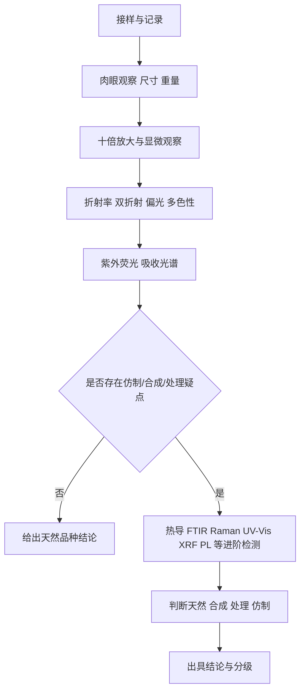

# 金银珠宝加工工艺与宝石知识

执行摘要：本稿以国家标准、珠宝国检、GIA 与博物馆保存资料为骨架，重建“材料—工艺—检测—估值—内容创作”链路；因当前环境未能直接读取你上传 ZIP 内 Markdown，文末已列出需单独补传的文件清单，以便后续把内部资料嵌回版面。

## 为什么标准银会成为银饰主流

**公开事实**：在中国现行贵金属首饰命名与印记规则中，银首饰应按纯度标注，例如“银925、Ag925、S925”；“足银、千足银”首饰的配件银含量也不得低于 925‰。这意味着“925”首先是一个纯度与命名问题，而不是单纯的营销说法。citeturn0search4turn2search4

**公开事实**：银本身属于相对柔软、延展性很强的金属，纯银密度约 10.5 g/cm³、熔点约 961.78℃；铜的密度约 8.96 g/cm³、熔点约 1084.62℃。行业中所谓“925 银”通常是以银为主体、加入其他金属提高加工适应性与佩戴稳定性；从材料逻辑上看，它比高纯银更适合做薄壁结构、活动件和宝石镶嵌。citeturn16view0turn17view1

**公开事实**：珠宝国检与中宝协发布的《二〇二二中国银饰银器产业白皮书》指出，925 银饰已成为国际常见的银饰成色标准品类，国内市场中其消费场景更偏日常佩戴、款式更偏时尚化，同时银饰的“珠宝化”趋势，正在通过宝石镶嵌、珐琅、花丝等工艺体现出来。citeturn0search5turn13search0

### 常见金属与表面处理对照表

| 材料或处理 | 典型成分或结构 | 关键物理参数 | 优点 | 风险或短板 | 常见鉴别方法 | 典型价格区间 |
|---|---|---|---|---|---|---|
| 足银/高含量银 | 银含量按命名规则为高含量银 | 纯银密度约 10.5 g/cm³；熔点约 961.78℃ | 光泽柔和、延展性好、文化认知高 | 较软，薄件、活动件与爪位更易变形；易失光、易发黑 | 看印记；XRF 测纯度；必要时化学法/ICP 复核 | 未指定 |
| 标准银 | 银含量 925‰ | 纯度明确；合金密度与熔程随配方变化，标准未统一指定 | 兼顾可塑性、强度与镶嵌适应性，是时尚银饰主流 | 仍会氧化失光；不同配方耐蚀性与颜色略有差异 | 看“银925/Ag925/S925”等印记；XRF；密度综合法 | 未指定 |
| 银镀金 | 银或标准银基体 + 金覆盖层 | 覆盖层厚度与附着强度可按标准检测；公开资料未给统一通用膜厚 | 以较低金属成本获得金色外观 | 覆盖层磨损后会露出基体；边角位先耗损 | XRF 测膜厚与表层成分；观察磨耗位置 | 未指定 |
| 银镀铑/白亮层 | 银或其他贵金属基体 + 铑覆盖层 | 覆盖层按检测标准测厚；铑层主要承担表面效果与抗失光 | 亮度高、颜色更“冷白”、有助于延缓失光 | 覆盖层薄则边缘先磨耗；后期通常需重镀 | XRF 测层；观察高点磨耗与露底色差 | 未指定 |
| 氧化做旧 | 多为银表面化学着色/硫化后形成深色层 | 本质是表面反应层，不是新金属覆盖层 | 强调纹理、层次和“旧感” | 高点会先磨亮；过度处理会显脏或发灰 | 看凹槽与高点反差；必要时结合表层分析 | 未指定 |
| 镀黑/黑色表面层 | 常见为黑铑、黑钌或其他黑色表面处理 | 以表面层实现黑色，具体膜厚视体系而定，公开统一值未指定 | 黑白反差强，视觉风格现代，便于突出宝石 | 掉层、发雾、边角露底更明显；与“氧化黑”容易混淆 | XRF 表层元素；高点掉色观察；截面或显微观察 | 未指定 |

数据依据：贵金属命名与印记规则来源于 GB 11887；纯银、金、铜的基础物性来源于 RSC；贵金属覆盖层的厚度与附着强度属于国家标准与珠宝国检可检测项目。citeturn0search4turn2search4turn16view0turn17view0turn17view1turn34search0turn33search2

### 知识补充

**行业共识**：消费者常把“纯度更高”误解为“更高级”。但在首饰里，材料评价要和结构一起看：戒臂薄不薄、耳针会不会弯、爪镶牢不牢、活动扣件会不会疲劳，往往比“多了几十个千分点纯度”更影响使用体验。银饰创作里，纯度、结构、表面处理和售后维护必须一起讨论。citeturn13search0turn22view0

### 编者观点

“为什么越纯不一定越好”是非常强的问题入口。它天然能拆成三层镜头：第一层拍印记，第二层拍结构，第三层拍佩戴磨损。对短视频来说，最有效的不是空讲“925 更耐用”，而是把高纯银薄件、标准银爪位、镀层边缘磨耗三种细节摆在一个画面里，让观众自己得出结论。

## 为什么同样是黑色，有的叫氧化，有的叫镀黑

**公开事实**：银在空气中会逐渐失去光泽，其中一个核心原因是表面与含硫化合物反应，形成黑色硫化银。RSC 对银的性质说明中明确提到，银会因空气中的硫化物而生成暗色硫化银；珠宝国检收录的学术论文摘要也将银制品变色原因概括为氧化反应、硫化反应和环境影响。citeturn16view0turn32search0

**公开事实**：覆盖层饰品与基体本色饰品在检测上是两套逻辑。珠宝国检的检测能力说明明确写到：镀金、镀银、镀铑饰品可按 GB/T 32022 检测覆盖层厚度及附着强度；贵金属纯度则可按 GB 11887、GB/T 18043 等标准通过 XRF 等方法检测。也就是说，“氧化黑”更接近基体表面反应，“镀黑”则更接近新表面层。citeturn33search2turn34search0turn38search7

**行业共识**：在银饰制作里，“氧化”通常指利用化学反应把银表层做成更深颜色，目的是让纹路更立体、浮雕更有层次；“镀黑”则更多是借助黑色金属系表层去获得均匀、稳定、风格化的黑。它们的视觉结果可能相似，但修复路径完全不同：前者多是重做表面，后者往往要评估掉层、露底与是否重镀。以珠宝行业公开产品与技术资料看，黑铑、黑钌都真实存在于现代珠宝表面处理中，因此“黑”并不天然意味着“老”或“复古”。citeturn29search1turn29search4turn29search2turn29search9

### 知识补充

**圈内观点/争议**：市场里最容易被混用的词就是“氧化黑”“做旧黑”“镀黑”。有的商家把一切发黑都叫氧化，有的则把一切均匀黑色都包装成高级镀层。真正有用的判断不是听名字，而是看三个点：颜色是在凹槽里更重还是整体均匀、磨损后是“亮银翻出”还是“露底色翻出”、实验室能否测到明确表层元素。citeturn33search2turn34search0turn34search2

### 编者观点

这部分特别适合拍“误会解除型”内容。钩子可以非常直接：“银发黑，不一定是脏；黑得很均匀，也不一定是老。”镜头上最有说服力的是同一件首饰的高点、凹点、边缘三连拍，再配一张 XRF 出图或检测证书页，内容就会从“鉴宝式猜测”升级成“表面工程识别”。

## 一件银饰是如何被做出来的

**公开事实**：中国已经建立了专门的传统金银工艺术语标准 GB/T 41609，用来规范传统制作、加工工艺的术语、定义及分类；同时，真实的高等级金属工艺案例往往不是单一工序，而是压制、铸造、执模、焊接、电镀、珐琅、组装等多工序叠加。珠宝国检转引的“七一勋章”制作案例就明确呈现出这种复合流程。citeturn26search0turn26search4turn4search2

流程说明：术语标准确认了传统工艺的规范化表达；实际制作案例显示，成品往往经历“熔炼—压制/铸造—执模—电镀/珐琅—组装”等复合工序。citeturn26search0turn4search2

**公开事实**：从检测与职业标准角度看，珠宝首饰相关的常规设备已经相当明确：十倍放大镜、卡尺、天平、折射仪、分光镜、偏光镜、热导仪、冷光源、紫外荧光灯、宝石显微镜、红外光谱仪、紫外—可见分光光度计、X 射线荧光光谱仪等，都属于常规检验设备；贵金属方向的中级技能要求还明确包含测金仪校准、密度仪选择、样品表面清洁与标准物质选择。citeturn21view0turn22view1

**行业共识**：如果不追求“工厂配方级”细节，首饰制作里真正决定成败的关键参数可以概括为六类：合金液状态、模具/包埋体系状态、焊料熔程与热影响区、表面粗糙度与抛光粒度、覆盖层厚度与附着强度、镶嵌受力与金属边界留量。公开标准更强调“检测什么”，而不是替每家工厂公开“设多少度、跑多少秒”。这件事本身就说明：工艺价值，往往藏在参数控制能力里。citeturn33search2turn34search0turn22view1turn25search2

### 建议插图

建议优先使用你自己的高分辨率工坊图：一张“注蜡树—铸造后毛坯—执模后半成品—表面处理后成品”的时序四联图，外加一张十倍放大下的焊点/砂眼细节。如果暂时没有内部图片，可先参考 GIA 的镶工提示中的工具、镶爪与表面缺陷示意，以及珠宝国检检测服务页的仪器场景，后续再替换为品牌自有素材。citeturn25search0turn33search2

### 编者观点

这部分最适合做“制造纪录片感”。不要从成品开拍，而要从“丑”的阶段开拍：蜡树、毛坯、焊点、锉痕、未抛状态，最后才给出成品。观众一旦看到“好看”是怎么被一点点磨出来的，对价格和工艺的尊重会显著提升。

## 如何判断工艺质量，发现缺陷并选择修复

**公开事实**：国家职业技能标准对首饰外观检查提出了非常具体的可观察要求：印记应可识别；外观应平直、圆整；搭扣应吻合；焊接要牢固、无虚焊，焊点应饱满、无明显焊疤；表面应光洁，无砂眼、裂痕；镶嵌方式也应能区分并判断是否合格。citeturn22view0

**公开事实**：对镶嵌质量，GIA 的工艺文章给出的标准非常直白：镶爪尖端应牢牢固定在宝石冠部，镶爪和宝石之间不应有缝隙，不齐平的爪尖容易钩衣、划皮肤或导致宝石受损；对密镶/珠镶类设计，还要保留足够金属边界以维持结构完整。citeturn25search2

**行业共识**：首饰缺陷可以按“结构、表面、镶嵌、覆盖层”四类来抓。结构类看虚焊、裂口、活动件松旷；表面类看砂眼、划痕、橘皮、抛光死角；镶嵌类看爪位、边镶、槽镶是否吃石足够；覆盖层类看边缘掉色、孔位露底、色差与附着不良。若往制造根因追溯，铸造阶段常见的气孔、缩松、冷隔、夹杂与裂纹，会在后续执模、抛光、镶嵌时被不断放大。citeturn22view0turn24search1turn24search3

**公开事实**：银器与银合金的失光/发黑可以通过机械、化学或电化学方式去除；但博物馆保存与金属保护资料反复强调，抛光和清洁会不可逆地去除一部分金属，因此历史件、Vintage 件和有原始表面证据的物件应采用“最小干预”思路。citeturn36search17turn36search8turn36search14

### 常见缺陷与修复建议

| 缺陷类型 | 常见表现 | 更可能发生的工序 | 修复思路 | 判断是否值得修 |
|---|---|---|---|---|
| 虚焊/焊疤 | 接口发黑、焊缝不顺、轻压有松动 | 焊接、组装 | 局部拆修、重焊、再整形与再抛 | 结构件值得修；受力点不建议只“补表面” |
| 砂眼/气孔 | 抛光后出现细孔，局部发灰 | 铸造、执模 | 小孔可局部修整；深孔通常需补焊/激光补料后再整面 | 若孔洞在主视觉面，影响很大 |
| 镶石松动 | 爪尖不落位、晃石、边镶开口 | 镶嵌、佩戴疲劳 | 重整爪位、补金属、重新镶嵌 | 主石松动必须先修再戴 |
| 覆盖层磨损 | 边缘露底、局部掉色、白亮层变灰 | 电镀、日常磨耗 | 去旧层、整面、重镀；不要只补局部点色 | 若已露底色，局部涂抹式修补通常观感差 |
| 氧化层不均 | 高低面脏、纹路发糊、反差失控 | 做旧、佩戴、清洁不当 | 退黑重做，或局部提亮高点、重建层次 | 风格件可修，历史件慎做“过新”处理 |

修复原则依据：外观与焊接质量要求来自职业技能标准；覆盖层厚度与附着强度可按标准检测；银表面黑化去除会伴随金属损失，历史件宜谨慎。citeturn22view0turn33search2turn34search0turn36search17turn36search8

### 编者观点

“怎么判断值不值得修”比“怎么修”更适合大众内容。因为前者直接触发消费决策，后者才是工坊逻辑。拍摄时建议用三组极近镜头：焊点、爪位、边缘掉层。观众一旦学会看这三个位点，就会对“工艺感”和“售后价值”建立基础分辨力。

## 宝石为什么不能只看闪不闪

**公开事实**：中国现行宝石命名和鉴定以 GB/T 16552《珠宝玉石 名称》、GB/T 16553《珠宝玉石 鉴定》为基础，珠宝国检检测服务也明确说明，其对一百余种天然宝石、天然玉石、天然有机宝石及人工宝石进行检测，并对钻石按 GB/T 16554 进行颜色、净度、切工、质量分级。citeturn1search0turn37search6turn35search8

**公开事实**：从方法学看，宝石鉴定不是“凭经验看一眼”，而是按流程逐步排除。GB/T 16553 的公开文本列出了肉眼观察、放大检查、折射率/双折射率、偏光镜、二色性、吸收光谱、紫外荧光等基本项目；职业技能标准又补充了热导仪、红外、紫外—可见、XRF 等实验室手段。citeturn5view2turn21view0turn22view1

流程依据：公开标准已将肉眼、放大、折射、偏光、光谱、荧光等列为基础鉴定方法；行业职业标准将热导仪、红外、UV-Vis、XRF 等列为常规实验室设备。citeturn5view2turn21view0turn22view1

### 常见宝石与仿制品速查表

| 品类 | 代表性参数 | 常见问题 | 快速鉴别点 |
|---|---|---|---|
| 钻石 | 硬度 10；密度约 3.52；折射率 2.417；色散强 | 激光钻孔、充填、辐照、HPHT 处理；与培育钻石、莫桑石、CZ 混淆 | 看热导、显微包体、荧光/PL/红外；“导热高”不能单独当真钻结论 |
| 红宝石/蓝宝石 | 刚玉，硬度 9；密度约 4.00；折射率约 1.76 | 热处理、扩散、充填常见 | 看双晶纹、丝状包体、颜色集中、Pb 异常、红外/拉曼 |
| 祖母绿 | 硬度约 7.5–8；密度约 2.72；折射率约 1.577–1.583 | 浸油、充填、染色、覆膜 | 看三相包体、裂隙、闪光效应、红外有机吸收峰 |
| 珍珠 | 硬度低，约 2.5–4.5；海水密度约 2.61–2.85 | 漂白、增白、染色、辐照 | 看层状结构、钻孔/凹坑染料、表面砂感、必要时光谱 |
| 翡翠 | 硬度约 6.5–7；密度约 3.34；点测折射率常约 1.66 | 漂白浸蜡、充填、染色、覆膜 | 看“翠性”、纤维交织结构、红外蜡峰/树脂峰、表面沟渠状构造 |
| 合成立方氧化锆 | 硬度约 8.5；密度约 5.80；折射率约 2.15 | 常作仿钻材料 | 通常很洁净、密度显著高于钻石、火彩强、易显“假亮” |
| 合成碳硅石 | 硬度约 9.25；密度约 3.22；折射率约 2.648–2.691；双折射明显 | 常作仿钻材料，也常被热导笔误判 | 看重影、双折射、强火彩；热导高不等于天然钻石 |

说明：现行国家标准为 GB/T 16553-2017；上表中的代表性数值采用公开可检索的前版标准文本示例参数，仅用于内容创作与基础认知建立，最终品种与结论仍以实验室实测为准。citeturn37search0turn37search6turn39view0turn7view1turn9view0turn10view0turn40view0turn12view0

### 仿制品、合成品与检测手段

**公开事实**：GIA 明确区分了“仿制钻石”和“实验室培育钻石”：仿制品只是外观相似，化学、物理、光学性质与钻石不同；实验室培育钻石则与天然钻石在这些性质上几乎相同，主要差别在形成历史，需要经验丰富的实验室与先进仪器识别。珠宝国检也说明其已具备天然、合成、处理钻石的检测能力，并依据企业标准开展培育钻石鉴定与品质评价。citeturn28view0turn28view1turn6search7turn6search10

**公开事实**：对仿钻市场最常见的 CZ 与莫桑石，GIA 的中文资料给出的是非常实用的消费级结论：CZ 价格更低、硬度 8.5、会比钻石更易划伤；合成碳硅石硬度更高、火彩更强，但因为双折射，从某些角度会出现背面刻面重影。与国家标准公开文本对 CZ、合成碳硅石的密度、折射率、双折射和热导特征结合起来看，最稳妥的识别路径不是“只用一支热导笔”，而是“热导 + 放大 + 光学 + 光谱”联合判断。citeturn28view0turn12view0turn21view1

### 编者观点

宝石内容最怕“神秘化”。真正能建立信任的，不是反复说“我一眼就看出来”，而是把观众也带进判断路径里：先看包体，再看折射，再看荧光，再说为什么要送实验室。把“判断过程”拍出来，内容就会从情绪型种草变成方法型种草。

## Vintage 与年份为什么不能只看旧不旧

**公开事实**：银饰首先要满足可识别的命名与印记规则，至少在纯度层面，印记是判断材料身份的第一关；同时，银及银合金在含硫环境中会逐渐形成表面失光和暗色层，而后期抛光、清洁又会带走一部分金属与表面证据。这意味着所谓“老味道”既可能来自自然使用，也可能来自后期做旧或错误翻新。citeturn0search4turn16view0turn36search16turn36search17

**行业共识**：Vintage 与年份判断，不能只看“黑不黑”，而要把五条线索叠起来看。第一，是印记体系：字体、位置、深浅、是否与时代/品牌系统一致。第二，是结构痕迹：手工锉痕、焊缝走向、背面收口、倒角方式。第三，是表面逻辑：高点是否自然发亮、凹处是否留黑、磨耗是否集中在真实接触位。第四，是镶嵌与宝石：切工、托位习惯、背部开窗方式是否符合当时工艺。第五，是维修史：重镀、重抛、换石会显著改变“老件证据”。这些判断大多属于行业经验联合，不是单一仪器一次性给结论。citeturn22view0turn25search2turn36search8

**圈内观点/争议**：市场中最常见的误区有两个。一个是把所有自然发黑都当“包浆”，忽略了脏污、腐蚀与不当存放也会形成难看的表面状态；另一个是把现代黑铑、黑钌、化学做旧误认为“天然老化”。公开产品与行业趋势资料已经反复表明，黑色表面处理完全可以是当代审美的一部分，不具备自动证明 Vintage 的能力。citeturn29search2turn29search7turn29search9

### 工艺为什么会直接影响价格与收藏价值

**公开事实**：银饰的价值并不只由克重决定。珠宝国检与中宝协的银饰白皮书明确指出，在当下中国市场，银饰的“珠宝化”与“饰品化”都越来越依赖设计、工艺、品牌价值与文化底蕴，而不是单纯的金属含量；同时，相比黄金，银饰的投资保值与流通变现属性更弱。citeturn13search0

**行业共识**：因此，价格与收藏判断通常要拆成三层。第一层是材料层：银多少、石头真假、有没有覆盖层。第二层是制造层：是批量铸造件，还是锻造/雕刻/花丝/手工修整比例高的件。第三层是证据层：品牌谱系、年份线索、保存状态、配套证书、维修历史。没有第三层，收藏价值很难稳；没有第二层，工艺溢价通常讲不长久。真实案例里，手工工序占比、传统技法复杂度和修整难度，往往都会变成讲价与讲故事的核心。citeturn4search2turn13search0

### 编者观点

这一节最适合做“反直觉”内容：不是越黑越老，不是越重越贵，也不是有 925 就一定真 Vintage。把“老”和“旧”、“做旧”和“自然氧化”、“材料价”和“工艺价”拆开讲，观众会明显感觉你在提供判断框架，而不是在制造神秘感。

## 如何把工艺和宝石知识变成可拍可讲的内容

### 可直接给编导使用的内容模块

**模块一：材料认知型**  
开头问题可以直接用：“为什么银越纯，反而未必越适合天天戴？”  
镜头建议是“印记特写—戒臂轻压测试—爪位侧面—佩戴磨损高点”。  
文案钩子建议用：“你以为 925 是妥协，其实它是首饰工程学。”  

**模块二：表面工程型**  
问题可以用：“发黑到底是氧化、做旧，还是掉层？”  
镜头先拍整体，再拍高点、凹点、边缘三个位点，最后插入检测逻辑图。  
文案钩子建议用：“首饰表面最会骗人，但也最容易露馅。”  

**模块三：制造纪录型**  
问题可以用：“一件银饰，为什么从毛坯到成品要过这么多手？”  
拍法上按时间顺序：蜡树、包埋、出坯、执模、焊接、预抛、镶嵌、终抛。  
关键细节不是工匠大景，而是毛坯的丑、焊点的热、抛光前后的反差。  

**模块四：鉴定教学型**  
问题可以用：“看起来都很闪，为什么实验室一句话就能把它们分开？”  
镜头建议是“裸眼—十倍放大—折射/热导—证书页”的四连跳。  
文案钩子建议用：“真正会看宝石的人，不会只说‘像不像’，会说‘先测什么’。”  

**模块五：Vintage 争议型**  
问题可以用：“越黑越老？越旧越值钱？这两个判断都危险。”  
镜头优先拍印记、背部、焊缝、托底和磨耗路径，不先拍正面美图。  
文案钩子建议用：“老件最大的线索，往往不在正面，反而在背面。”  

### 拍摄细节建议

最值得反复使用的特写位置有五个：印记、焊点、边角镀层、高点磨耗、宝石爪位。  
最容易建立专业感的道具不是豪华背景，而是十倍放大镜、卡尺、镊子、热导仪、折射仪或一页检测报告。  
最有传播力的对比不是“贵和便宜”，而是“同色不同工艺、同闪不同材料、同旧不同年份逻辑”。

### 编者观点

这类内容最怕讲成课程，最有效的方式永远是“一个误会 + 一个证据 + 一个反转”。观众不是来背标准号的，而是来学会下次买东西时多看哪一眼、少踩哪一个坑。只要每条内容都能回答一个真实购买问题，这一章就会天然具备转化能力。

## 需要补充的文件与数据清单

| 需补充项 | 用途 | 建议格式 | 当前状态 |
|---|---|---|---|
| ZIP 内的 Markdown 原文 | 把你已确认的三大框架、内部术语、品牌口径准确嵌回正文 | `.md` / `.txt` / `.docx` | 已上传 ZIP，但当前环境未能直接读取压缩包内文档；建议单独解压后重传 |
| README、output 目录索引 | 确认第二章资料的真实文件树与优先级 | `.md` / `.txt` / 截图 | 已在需求中提及目录名，需单独重传目录清单 |
| 产品知识库中的材质与工艺页 | 补足品牌真实用料、镀层策略、售后口径 | `.md` / `.pdf` / 表格 | 已置于 ZIP，建议抽取对应文件单独上传 |
| 第二章资料中的工艺说明图 | 替换本文中的公共流程图，提升内部一致性 | 高清图片 / `.pdf` | 已上传 ZIP，需单独导出 |
| 高分辨率产品细节图 | 用于编导拍摄对照：印记、焊点、爪位、背面、边缘磨耗 | 原图 `jpg/png`，长边建议不低于 3000px | 需确认是否已在 ZIP；建议单独重传 |
| 实验室检测报告 | 纯度、镀层厚度、宝石品种、仿制/处理证据 | `pdf` | 未确认；如已有请补传 |
| 特定年份产品清单 | 用于 Vintage/年份辨识与 logo/印记演变梳理 | 表格 `xlsx/csv` | 需补传 |
| 维修与返修记录 | 用于“常见缺陷与修复”部分替换公共案例 | 表格 / 工单截图 | 需补传 |
| 品牌历史印记与 Logo 变化表 | 用于年份与真伪线索的视觉化说明 | 表格 / 时间线 | 需补传 |
| 内部短视频爆款样本或脚本库 | 让“编导模块”更贴近你现有账号风格 | `docx/md/xlsx` | 需补传 |

**资料使用说明**：本稿已优先采用公开标准、珠宝国检、GIA 与保存修复机构资料搭建可排版底稿。待你把 ZIP 内关键 Markdown、图片与检测文件单独补传后，最适合二次深化的部分是三处：品牌专属工艺口径、Vintage 年份线索、以及“可拍内容模块”的镜头脚本化。